# Hidden Gems Travel - AI Booking, Dispatch and Cash-Ledger Automation

An end-to-end automation I built for a small tour company this is just a demo, built with **n8n** and **Python**. A customer chats with an AI agent in their own language, gets a booking and a payment link, a driver is assigned through chat buttons, and on-site payments land in a Google Sheet ledger. A dedicated error handler emails the owner with the cause and troubleshooting steps whenever something breaks.

> **About this project:** This is a **demo project** I built to show how I would solve this kind of problem. It is based on a real-world brief for a tour operator (AI agent, booking system, payments, driver dispatch, cash ledger), but it is **not a delivered client system**. The company, tours, customers, prices and sheet data are all fictional or randomly generated. Bokun and Stripe run in a **demo mode** with mocked responses until real API keys are added.

## Demo video

[`docs/video/hidden-gems-travel-walkthrough.mp4`](docs/video/hidden-gems-travel-walkthrough.mp4) is a 99-second subtitled walkthrough (no audio).

## What it does

| Part | Workflow | What it does |
|---|---|---|
| 1 | Customer AI agent | Answers in IT / EN / ES / FR / PT, reads real tour data through a tool, remembers the conversation, hands off to a human for refunds or anything it cannot answer |
| 2 | Booking and payment | Python validates the request and calculates the price **server-side**, signs the Bokun request (HMAC-SHA1), creates the booking, and creates a Stripe Checkout link. A Stripe webhook marks the booking paid and triggers dispatch |
| 3 | Driver dispatch | Sends the paid job to drivers with Accept / Decline buttons. First to accept wins, state is kept in a Google Sheet |
| 4 | Cash ledger | Drivers type `/cash`, `/card`, `/handover` or `/balance`. Python parses the command, appends a row, and replies with the cash the driver is holding |
| - | Error handler | Classifies the error into one of ten categories, sets severity, adds business impact and troubleshooting steps, sends an HTML email, and logs to a sheet |
| - | Telegram customer bot | A WhatsApp stand-in so the full conversation can be tested from a phone |
| - | E2E test runner | Plays a fake customer through all four parts and reports PASS / FAIL per check. Can run daily and alert through the error handler |

## Workflow images

The workflow images are **diagrams rendered from the exported workflow JSON files**, not screenshots of the n8n editor. The sheet images are illustrations with **randomly generated sample data**.

### Part 1 - Customer AI agent
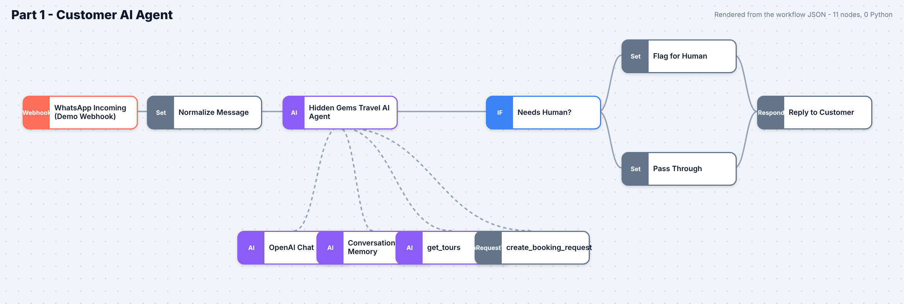

### Part 2 - Booking and payment
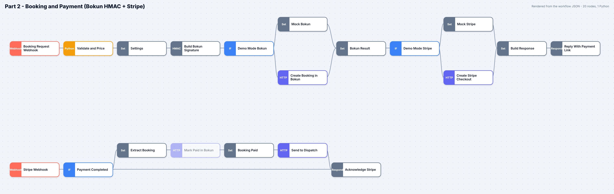

### Part 3 - Driver dispatch
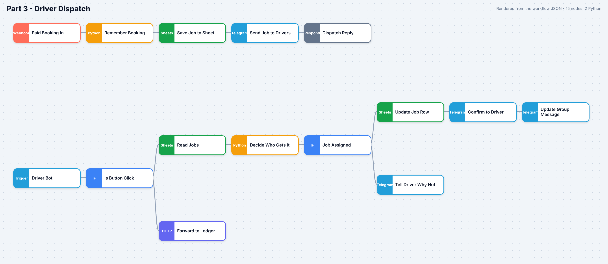

### Part 4 - Cash ledger
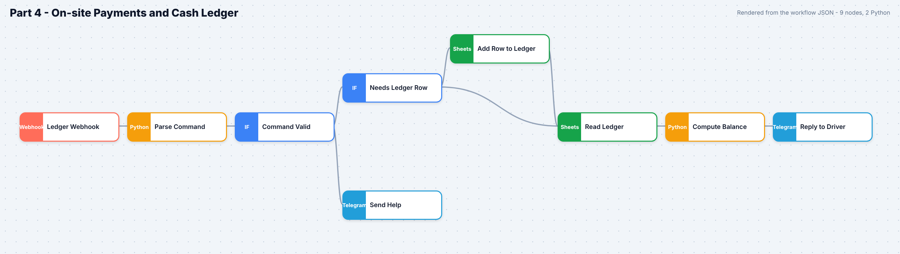

### Error handler
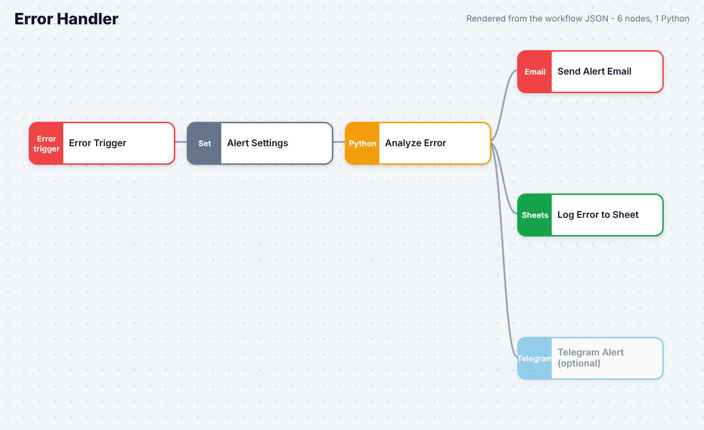

### Error alert email
This is the actual HTML produced by the error handler's Python code for a sample Stripe authentication failure ([source HTML](docs/error-report-sample.html)).

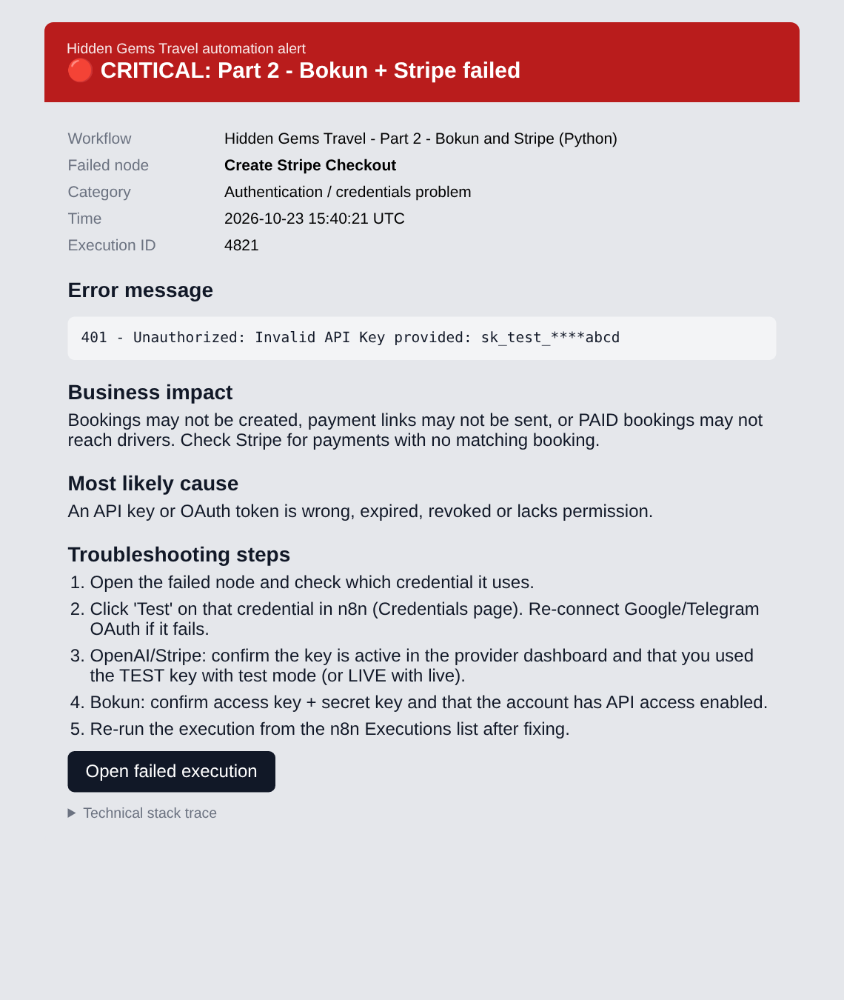

### Telegram customer bot and E2E test runner
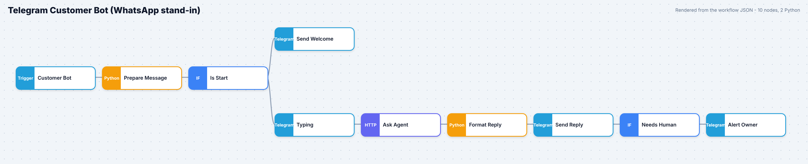
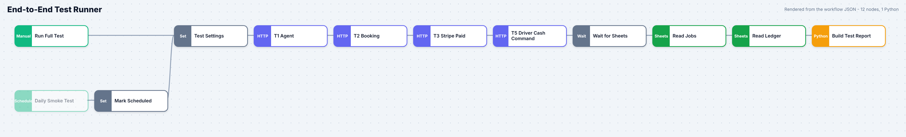

## Google Sheets (sample data)

| Jobs | CashLedger | ErrorLog |
|---|---|---|
| 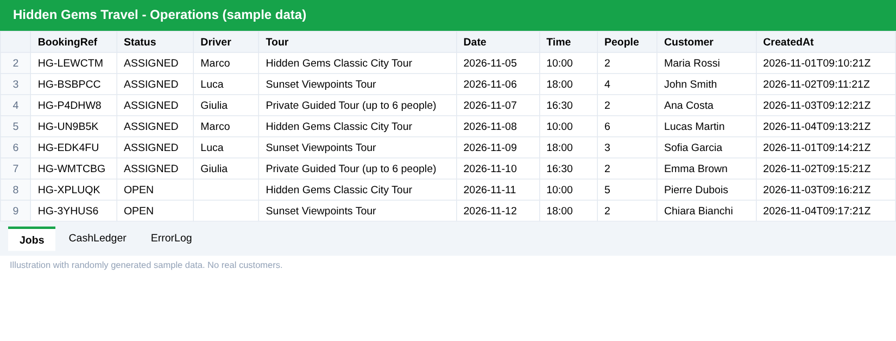 | 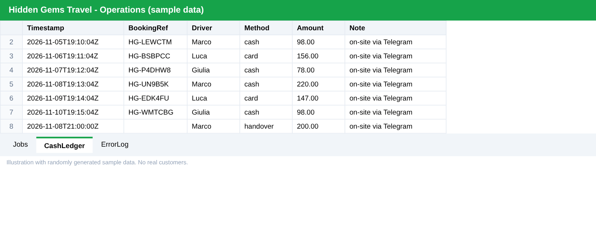 | 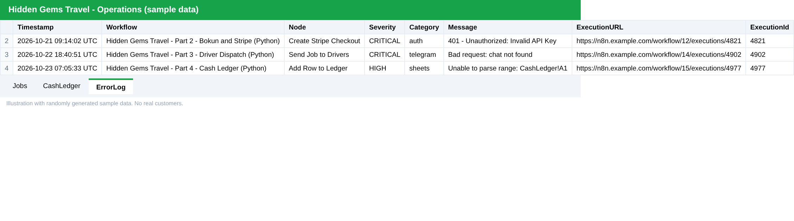 |

## Design decisions

- **The AI never sets the price.** Prices live in Python on the server, so a customer cannot talk the bot into a discount.
- **Strict validation.** Unknown tours, past dates, bad group sizes and missing names are rejected before anything is created.
- **Append-only ledger.** Rows are never edited, which keeps the cash history auditable.
- **Failures are explained, not just reported.** The alert email includes the likely cause, the business impact and numbered troubleshooting steps.
- **Self-testing.** The E2E runner can run every morning and raises an error, and so an alert, if any check fails.

## Setup

1. Import the files in `workflows/` into n8n (**Create workflow -> Import from file**), one workflow per file. Start with `05-error-handler.json`.
2. Create credentials: OpenAI, two Telegram bots (drivers and customers), Google Sheets, SMTP.
3. Create a Google Sheet with tabs `Jobs`, `CashLedger`, `ErrorLog` (headers are in each workflow's sticky notes) and paste its ID into the Google Sheets nodes.
4. Publish the workflows and replace every `localhost:5678` placeholder with the production webhook URL of the workflow it calls.
5. Set **Error workflow** to the error handler in each workflow's settings.
6. Run `07-e2e-test-runner.json` or `scripts/e2e-test.sh` to check the whole chain.

Telegram webhooks need a public HTTPS URL (n8n Cloud, or a tunnel when self-hosting with `WEBHOOK_URL` set).

## Tech

n8n - Python - OpenAI - Stripe - Bokun API (HMAC) - Telegram Bot API - Google Sheets
